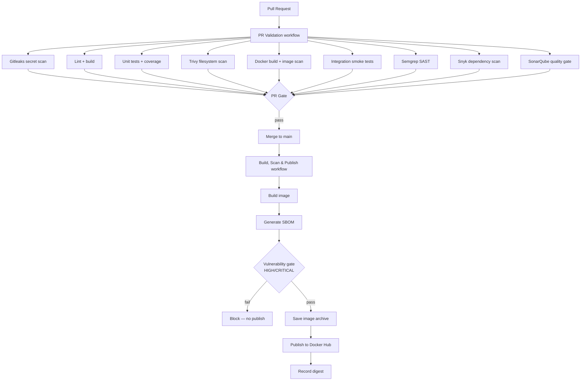

# Boutique Microservices — DevOps Stack

A portfolio-grade microservices e-commerce application with a production-minded CI/CD pipeline featuring automated container builds, vulnerability scanning, SBOM generation, and Docker Hub publishing.

---

## Services

| Service         | Port | Description                     |
| --------------- | ---- | ------------------------------- |
| frontend        | 3000 | React + TypeScript SPA (MUI)    |
| gateway         | 3001 | API gateway / reverse proxy     |
| auth            | 3002 | Authentication and JWT issuance |
| product-service | 3003 | Product catalog (TypeScript)    |
| order-service   | 3004 | Order processing (JavaScript)   |
| orders          | 3005 | Order management (TypeScript)   |
| user-service    | 3006 | User profiles (TypeScript)      |

---

## CI/CD Architecture



### Two-workflow model

| Workflow            | Trigger               | Publishes images? | Exposes registry credentials? |
| ------------------- | --------------------- | ----------------- | ----------------------------- |
| `pr-validation.yml` | Pull requests to main | No                | No                            |
| `build-publish.yml` | Push to main / manual | Yes               | Only after all gates pass     |

**Why separate workflows?** PR validation runs untrusted contributor code. Mixing registry credentials into that workflow risks secret exposure. The publishing workflow runs only on trusted, merged code.

---

## Build & Publish Workflow

### Triggers

- **Automatic:** every merge to `main`
- **Manual:** `workflow_dispatch` from the GitHub Actions UI (any authorised actor)

### Job sequence

```
build-scan-sbom  (matrix × 7 services, parallel)
       │
       ▼  all must pass
    publish      (matrix × 7 services, parallel)
       │
       ▼  always
  release-summary
```

### What each job does

**`build-scan-sbom`**

1. Checks out the trusted source revision.
2. Builds the production Docker image.
3. Generates a CycloneDX JSON SBOM from the final image (evidence retained regardless of gate result).
4. Runs the Trivy vulnerability gate — blocks publication on HIGH or CRITICAL findings.
5. Saves the scanned image as a tar archive and uploads it as an artifact.

**`publish`**

1. Downloads the exact pre-scanned archive (no rebuild).
2. Logs in to Docker Hub — credentials are only present in this job.
3. Loads and pushes the SHA-tagged image.
4. Applies the `main` moving alias (push-to-main events only).
5. Captures and records the image digest.

**`release-summary`**

- Always runs; writes a structured digest table to the workflow summary.

---

## Image Naming and Tagging

### Registry namespace

```
docker.io/<DOCKERHUB_USERNAME>/boutique-<service>:<tag>
```

Example:

```
docker.io/myorg/boutique-auth:sha-<full-git-sha>
```

### Tags applied per publish

| Tag                  | Example           | Mutable? | Purpose                         |
| -------------------- | ----------------- | -------- | ------------------------------- |
| `sha-<full-git-sha>` | `sha-a1b2c3d4...` | No¹      | Primary deployment identifier   |
| `main`               | `main`            | Yes      | Convenience pointer for scripts |

¹ Tags are immutable by content-addressed digest, but Docker Hub does not enforce tag-name immutability on free plans. A tag name can be overwritten by pushing again. Use the digest for guaranteed identity (see below).

**`latest` is never applied.** Using `latest` as a deployment identifier makes rollback and audit impossible.

### Tag vs. digest

| Concept | Example                          | Mutable?                       |
| ------- | -------------------------------- | ------------------------------ |
| Tag     | `boutique-auth:sha-abc123`       | Yes — a name can be reassigned |
| Digest  | `boutique-auth@sha256:def456...` | No — content-addressed         |

To pull a specific, immutable image:

```bash
# By SHA tag (usually sufficient)
docker pull myorg/boutique-auth:sha-<full-git-sha>

# By digest (guaranteed identity, unaffected by tag mutation)
docker pull myorg/boutique-auth@sha256:def456...
```

Digests for each run are recorded in the workflow summary and as downloadable artifacts (`digest-boutique-*`).

---

## Vulnerability Policy

| Severity         | Fixed            | Action                     |
| ---------------- | ---------------- | -------------------------- |
| CRITICAL         | Available        | Block merge and publish    |
| HIGH             | Available        | Block merge and publish    |
| CRITICAL / HIGH  | No fix available | Allowed (--ignore-unfixed) |
| MEDIUM and below | Any              | Allowed                    |

The policy is enforced **identically** in both workflows via `.trivy.yaml`, which is the single source of truth for severity level, `ignore-unfixed`, and the ignorefile path. Both the PR image scan (`docker-build` job) and the publish vulnerability gate (`build-scan-sbom` job) reference this file, ensuring a finding that blocks publishing is also caught before merge.

**Rationale for `--ignore-unfixed`:** base images and npm tooling frequently carry unfixed CVEs with no available remediation. Blocking on these would prevent publishing otherwise-clean services. This is a documented trade-off, not silent suppression.

**`skip-dirs` is not used for image scans** in either workflow. Excluding system library paths (`/usr/local/lib`, `/usr/lib`) hides OS package vulnerabilities and creates a false sense of security.

### Exceptions

Documented exceptions are in `.trivyignore` at the repo root. Each entry must include:

- CVE ID
- Affected package and scope (build-time only, OS package, etc.)
- Rationale (why blocking is not appropriate)
- Owner and review date

Do not add CVE IDs to `.trivyignore` merely to make CI green.

---

## SBOM

**Format:** CycloneDX JSON (`*.cdx.json`)

**Naming:** `sbom-boutique-<service>` artifact, file `boutique-<service>-sha-<sha>.cdx.json`

**Contents:** OS packages and application dependencies discovered in the final production image by Trivy.

**Retention:** 30 days as a GitHub Actions artifact.

**When generated:** Before the vulnerability gate — retained even if the gate blocks publication.

**Limitations:**

- SBOMs are stored as GitHub Actions artifacts, not attached to Docker Hub images.
- SBOMs are not cryptographically signed or attested in the current implementation.
- Attestation via `docker buildx imagetools` or `cosign` is a documented future enhancement.

To download an SBOM:

```
GitHub Actions run → Artifacts → sbom-boutique-<service>
```

---

## Configuring Docker Hub Credentials

You must configure the following in your GitHub repository settings before the workflow can publish:

### 1. Repository Secrets

`Settings → Secrets and variables → Actions → Secrets → New repository secret`

| Name                 | Value                                    |
| -------------------- | ---------------------------------------- |
| `DOCKERHUB_USERNAME` | Your Docker Hub username or organisation |
| `DOCKERHUB_TOKEN`    | A Docker Hub Personal Access Token       |

Both are stored as secrets so they do not appear in workflow logs or in expression expansions visible to untrusted code.

**Create the PAT on Docker Hub:** Account Settings → Security → New Access Token.

Recommended PAT permissions: **Read, Write, Delete** scoped to the target repositories only. Do not use your Docker Hub password.

### 3. (Optional) Docker Hub tag immutability

Docker Hub supports tag immutability on paid (Team/Business) plans. To protect the `sha-*` tags:

1. Navigate to each repository on Docker Hub.
2. Enable **Tag immutability** under repository settings.
3. Immutability prevents the same tag name from being overwritten after it is pushed.

This is recommended for the `sha-<sha>` tags. The `main` tag must remain mutable (by design).

---

## Finding Published Image Digests

### In the GitHub UI

1. Navigate to the Actions tab.
2. Open the relevant **Build, Scan & Publish** run.
3. Scroll to the **workflow summary** at the bottom — a table of images and digests is written there.
4. Alternatively, download the `digest-boutique-<service>` artifact from the run's artifact list.

### From the command line

```bash
# Inspect a pushed image to retrieve its digest
docker pull myorg/boutique-auth:sha-<sha>
docker inspect myorg/boutique-auth:sha-<sha> \
  --format '{{index .RepoDigests 0}}'

# Pull by digest (immutable reference)
docker pull myorg/boutique-auth@sha256:<digest>
```

---

## Running Locally with Docker Compose

```bash
cd projects/boutique-microservices

# Build and start all services
docker compose up --build -d

# Check service health
curl http://localhost:3002/health   # auth
curl http://localhost:3003/health   # product-service

# Tear down
docker compose down -v
```

---

## What Is Implemented vs. Future Enhancements

### Implemented

- [x] Build images from correct Dockerfiles with correct build contexts
- [x] Commit SHA image tags (`sha-<full-sha>`) — traceable to source
- [x] `main` moving alias on push-to-main
- [x] Trivy vulnerability gate (HIGH/CRITICAL, `--ignore-unfixed`)
- [x] CycloneDX SBOM generation per service from the final image
- [x] SBOM retained as 30-day GitHub Actions artifact
- [x] Artifact integrity: scan and publish operate on the same tar archive
- [x] Registry credentials isolated to publish job only
- [x] Image digest capture and workflow summary
- [x] `.dockerignore` for frontend and backend build contexts
- [x] Documented `.trivyignore` exceptions with rationale
- [x] Least-privilege GitHub token permissions
- [x] Concurrency control (no concurrent publishes to same ref)

### Future Enhancements

- [ ] **SHA-pin third-party actions** — `docker/login-action`, `docker/setup-buildx-action`, and `aquasecurity/trivy-action` are currently referenced by version tag. Pin to commit SHAs and add renovatebot or dependabot to keep them updated.
- [ ] **SBOM attestation** — Attach SBOMs to images as OCI artifacts using `cosign attest` or `docker buildx imagetools`. Requires cosign setup and a key management decision.
- [ ] **Provenance attestation** — Generate SLSA build provenance using `actions/attest-build-provenance`. Requires `id-token: write` permission.
- [ ] **Tag immutability on Docker Hub** — Enable on Team/Business plan for `sha-*` tags.
- [ ] **Semantic version tags** — Add `v*` tag support for formal releases triggered by git tags.
- [ ] **Multi-platform builds** — Add `linux/arm64` via `docker buildx` with `--platform linux/amd64,linux/arm64`. Requires re-evaluating the save/load artifact strategy (OCI layout instead of single-platform tar).
- [ ] **Scheduled rescan** — A weekly workflow that re-scans published images against the latest Trivy DB to catch newly disclosed CVEs in already-deployed images.
- [ ] **Base image update automation** — Renovatebot or Dependabot configuration to open PRs when `node:22-alpine` receives a patch.

---

## Security Posture

This project implements a **security-conscious CI/CD pipeline** suitable as a portfolio demonstration. It is not a fully production-hardened supply chain and should not be represented as such without the following additional controls:

- SBOM attestation and signing (cosign)
- SLSA provenance generation and verification
- Registry tag immutability
- Dependency update automation
- Runtime security (admission controllers, policy enforcement)
