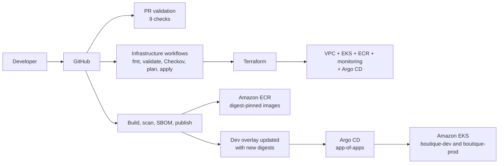
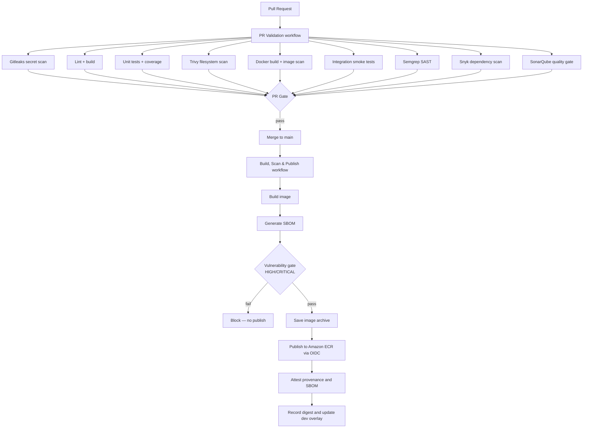

# End 2 End Microservices — DevOps Stack

A microservices e-commerce application deployed to **Amazon EKS**. Terraform builds the AWS platform, GitHub Actions validates, scans and publishes every image to **Amazon ECR** through OIDC, and **Argo CD** deploys the result from Git.

---

## Services

| Service         | Port | Description                     |
| --------------- | ---- | ------------------------------- |
| frontend        | 3000 | React + TypeScript SPA (MUI)    |
| gateway         | 3001 | API gateway / reverse proxy     |
| auth            | 3002 | Authentication and JWT issuance |
| product-service | 3003 | Product catalog (TypeScript)    |
| order-service   | 3004 | Order processing (JavaScript)   |
| orders          | 3005 | Order management (TypeScript)   |
| user-service    | 3006 | User profiles (TypeScript)      |

---

## Platform Overview



| Layer | What is used | Where |
| ----- | ------------ | ----- |
| Infrastructure as code | Terraform modules: `vpc`, `eks`, `ecr`, `argocd`, `monitoring` | `Infrastructure/` |
| Container registry | Amazon ECR, immutable tags, scan on push, GitHub OIDC push role | `Infrastructure/modules/ecr` |
| GitOps | Argo CD app-of-apps with `boutique-dev`, `boutique-prod` and `monitoring` applications | `argocd/` |
| Kubernetes manifests | Kustomize base plus `dev` and `prod` overlays (Ingress, Postgres StatefulSet, ServiceMonitors, Grafana dashboard) | `k8s/` |
| Observability | kube-prometheus-stack (Prometheus and Grafana) installed by Argo CD | `argocd/apps/base/monitoring.yaml` |
| CI/CD | Four workflows: PR validation, build and publish, infrastructure validation, infrastructure deploy | `.github/workflows/` |

---

## CI/CD Architecture



### Two-workflow model

| Workflow            | Trigger               | Publishes images? | Exposes registry credentials? |
| ------------------- | --------------------- | ----------------- | ----------------------------- |
| `pr-validation.yml` | Pull requests to main | No                | No                            |
| `build-publish.yml` | Push to main / manual | Yes (ECR)         | Only after all gates pass (short-lived OIDC role, no stored keys) |

**Why separate workflows?** PR validation runs untrusted contributor code. Giving that workflow access to the registry would put the push role at risk. The publishing workflow runs only on trusted, merged code.

---

## Build & Publish Workflow

### Triggers

- **Automatic:** every merge to `main` (commits that only change `k8s/overlays/*/kustomization.yaml` are ignored, so the workflow does not trigger itself)
- **Manual:** `workflow_dispatch` from the GitHub Actions UI

### Job sequence

```
build-scan-sbom  (matrix × 7 services)
       │
       ▼  all must pass
    publish      (matrix × 7 services: push to ECR, attest, record digest)
       │
       ▼
  update dev overlay  (kustomize edit set image, committed back to main)
       │
       ▼
  release-summary
```

### What each job does

**`build-scan-sbom`**

1. Builds the production Docker image once.
2. Generates a CycloneDX JSON SBOM from the final image (kept even if the gate blocks publishing).
3. Runs the Trivy vulnerability gate, which blocks on HIGH or CRITICAL findings that have a fix.
4. Saves the scanned image as a tar archive and uploads it as an artifact.

**`publish`**

1. Downloads the exact pre-scanned archive (no rebuild), so the published image is the scanned image.
2. Assumes an AWS role through GitHub OIDC. Credentials exist only in this job and expire when it ends.
3. Pushes the `sha-<full-git-sha>` tag to Amazon ECR and captures the image digest.
4. Creates signed SLSA build provenance and an SBOM attestation bound to that digest.

**`update dev overlay`**

- Writes the ECR URIs and immutable `sha256` digests into `k8s/overlays/dev/kustomization.yaml`. Argo CD then syncs dev automatically. **Prod is promoted by hand** by copying validated digests into the prod overlay.

**`release-summary`**

- Always runs and writes a table of images and digests to the workflow summary.

---

## Infrastructure Workflows

| Workflow | Trigger | What it does |
| -------- | ------- | ------------ |
| `infra-validation.yml` | Pull requests that touch `Infrastructure/` | `terraform fmt`, validate with TFLint, Checkov security scan, a plan, and an **Infra PR Gate** |
| `infra-deploy.yml` | Push to `main`, manual dispatch, weekly schedule | Plan, then apply behind the `infrastructure` environment's **manual approval**. Manual runs can be plan-only. A Monday 06:00 UTC plan-only run reports drift. |

AWS access in both workflows uses GitHub OIDC with no long-lived keys.

---

## Image Naming and Tagging

### Registry

```
<account-id>.dkr.ecr.<region>.amazonaws.com/<service>:<tag>
```

ECR repositories are created by Terraform with **immutable tags** and **scan on push**.

### Tags and digests

| Concept | Example | Mutable? |
| ------- | ------- | -------- |
| Tag | `auth:sha-<full-git-sha>` | No (ECR enforces tag immutability) |
| Digest | `auth@sha256:def456...` | No (content-addressed) |

**`latest` is never applied.** It makes rollback and audit impossible. Deployments reference the digest, which Kustomize writes into the overlay.

### Verifying an image

```bash
gh attestation verify oci://<registry>/<service>@sha256:<digest> --owner gitcliff
```

---

## Vulnerability Policy

| Severity         | Fixed            | Action                     |
| ---------------- | ---------------- | -------------------------- |
| CRITICAL         | Available        | Block merge and publish    |
| HIGH             | Available        | Block merge and publish    |
| CRITICAL / HIGH  | No fix available | Allowed (--ignore-unfixed) |
| MEDIUM and below | Any              | Allowed                    |

The policy is enforced **identically** in both workflows via `.trivy.yaml`, which is the single source of truth for severity level, `ignore-unfixed`, and the ignorefile path. Both the PR image scan (`docker-build` job) and the publish vulnerability gate (`build-scan-sbom` job) reference this file, ensuring a finding that blocks publishing is also caught before merge.

**Rationale for `--ignore-unfixed`:** base images and npm tooling frequently carry unfixed CVEs with no available remediation. Blocking on these would prevent publishing otherwise-clean services. This is a documented trade-off, not silent suppression.

**Scope of `ignore-unfixed`:** In Trivy 0.69.x this flag suppresses OS-package CVEs with status `will_not_fix` or `fix_deferred`. Node.js (npm) findings with status `affected` and no fixed version are **not** suppressed by this flag and must be handled via explicit `.trivyignore` entries.

**`skip-dirs` is not used for image scans** in either workflow. Excluding system library paths (`/usr/local/lib`, `/usr/lib`) hides OS package vulnerabilities and creates a false sense of security.

### Exceptions

Documented exceptions are in `.trivyignore` at the repo root. Each entry must include:

- CVE ID
- Affected package and scope (build-time only, OS package, etc.)
- Rationale (why blocking is not appropriate)
- Owner and review date

Do not add CVE IDs to `.trivyignore` merely to make CI green.

---

## SBOM and Attestations

**Format:** CycloneDX JSON (`*.cdx.json`), generated by Trivy from the final production image.

**Where it lives:**

- As a 30-day GitHub Actions artifact: `sbom-<service>`
- As a signed **SBOM attestation** bound to the pushed image digest (`actions/attest-sbom`)

**Provenance:** `actions/attest-build-provenance` creates signed SLSA build provenance for each image digest.

**When generated:** before the vulnerability gate, so evidence is kept even when the gate blocks publication.

**Limits:** attestations are stored in GitHub's attestation store, not attached to the ECR image as OCI artifacts, and nothing in the cluster verifies them yet (see Future Enhancements).

---

## Finding Published Image Digests

1. Open the relevant **Build, Scan & Publish** run in the Actions tab.
2. Read the table in the workflow summary, or download the `digest-<service>` artifact.
3. Or read them from the dev overlay: `k8s/overlays/dev/kustomization.yaml`.

---

## Running Locally with Docker Compose

```bash
cp .env.example .env        # set POSTGRES_PASSWORD and the JWT secrets

# Build and start all services
docker compose up --build -d

# Check service health
curl http://localhost:3002/health   # auth
curl http://localhost:3003/health   # product-service

# Tear down
docker compose down -v
```

---

## What Is Implemented vs. Future Enhancements

### Implemented

- [x] Terraform modules for VPC, EKS, ECR, Argo CD and monitoring, with plan, approval-gated apply and weekly drift detection
- [x] Infrastructure PR checks: format, validate, TFLint and Checkov
- [x] GitOps deployment with Argo CD (app-of-apps, dev and prod applications, automated sync with self-heal)
- [x] Kustomize base with dev and prod overlays
- [x] Build, scan and publish pipeline with the same Trivy policy in PRs and on publish
- [x] CycloneDX SBOM per service, kept as an artifact and attested to the image digest
- [x] Signed SLSA build provenance for every published image
- [x] Amazon ECR push through GitHub OIDC; the role is only available to the publish job
- [x] Immutable `sha-<full-sha>` tags, digest capture and digest-pinned deployments
- [x] Dev overlay updated automatically after each publish
- [x] Third-party actions pinned to commit SHAs in the infrastructure and publish workflows
- [x] Least-privilege token permissions and concurrency control

### Future Enhancements

- [ ] **Pin the remaining actions** (for example `bridgecrewio/checkov-action@master`) and add Dependabot or Renovate to keep pins current.
- [ ] **Verify attestations in-cluster** with an admission policy (Kyverno or Sigstore policy-controller).
- [ ] **External secrets for production:** replace the placeholders in `k8s/overlays/prod/secrets.yaml` with External Secrets or Sealed Secrets.
- [ ] **Prod promotion workflow:** replace the manual digest copy with a reviewed promotion pull request.
- [ ] **Semantic version tags** for formal releases.
- [ ] **Multi-platform builds** (`linux/arm64`); this needs the save/load artifact approach reworked.
- [ ] **Scheduled rescan** of published images against the latest Trivy database.
- [ ] **Base image update automation.**

---

## Known Limitations

- Production values are placeholders: `k8s/overlays/prod/secrets.yaml` and the `PENDING` image digests in the prod overlay must be replaced before a real production rollout.
- The files `argocd/values/monitoring-dev.yaml` and `monitoring-prod.yaml` contain placeholder Grafana admin passwords. The `monitoring` Argo CD application defines its own inline values and does not read these files today, but replace the passwords with an external secret before using them.
- Kubernetes secrets in the repository are demo values.

---

## Security Posture

This project implements a **security-conscious CI/CD pipeline and GitOps deployment** suitable as a portfolio demonstration. It is not a fully production-hardened platform. Still missing:

- Admission-time verification of image signatures and attestations
- External secret management for production
- Runtime security and network policy enforcement
- Dependency update automation
